<div align="center">

# 🛍️ E-Commerce Storefront

**A complete React storefront and admin dashboard for an ASP.NET Core Clean Architecture API.**


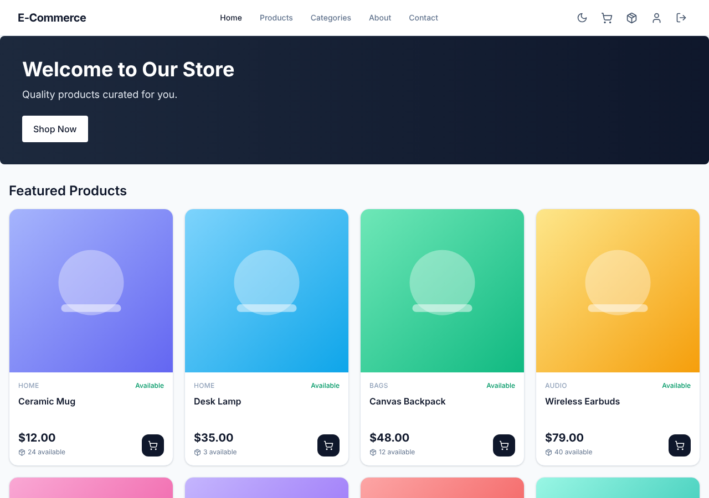

</div>

> Screenshots in this README were captured from the running app with **demo data**, so no real customers or orders appear.

---

## ✨ Features

### Customer
- **Browse and search** products with category, price range, in-stock and sort filters. Filters live in the URL, so any view can be shared or bookmarked.
- **Product page** with image gallery and zoom, quantity stepper limited to available stock, low-stock badge, and related products.
- **Cart** with live stock warnings ("Only 3 left", "Set to 2"), **save for later**, and a blocked checkout while an item is unavailable.
- **Two-step checkout**: choose address and payment method (cash on delivery or bank transfer), then review and place the order.
- **Order tracking** with a progress bar (Placed → Confirmed → Processing → Shipped → Delivered), cancellation while allowed, payment status, and **Buy again**.
- **Address book** with a default address, plus a profile page with password change.

### Admin
- **Dashboard** with revenue, collected and outstanding payments, average order value, daily sales chart, orders by status, top products and low-stock list. Includes date presets and **change vs the previous period**.
- **Order management**: filter, search by order number or customer, approve or advance orders one step at a time, **bulk advance**, **export to CSV**, and **print invoices and packing slips**.
- **Products**: create and edit, upload and reorder images, set the primary image, activate or deactivate, and adjust stock.
- **Categories, customers and inventory** screens.

### Experience and engineering
- 🌙 **Dark mode** that follows your system and remembers your choice.
- 📱 **Responsive**, with a slide-out mobile menu and a sticky "Add to cart" bar on phones.
- ⚡ **Route-level code splitting** and skeleton loaders instead of spinners.
- 🔐 **JWT auth** with a single shared token refresh, so parallel requests never race.
- 🧱 Error boundary, friendly 404 page, skip-to-content link, and keyboard-friendly dialogs.
- ✅ **Unit and component tests** for the logic that matters most (stock rules, order flow, CSV export, error handling).

---

## 📸 Screenshots

### Shopping

| Products (light) | Products (dark) |
|---|---|
| 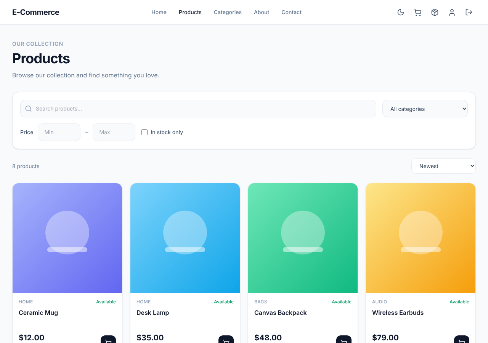 | 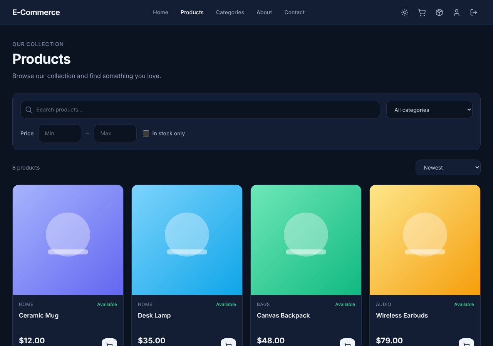 |

| Product details | Cart with stock warnings |
|---|---|
| 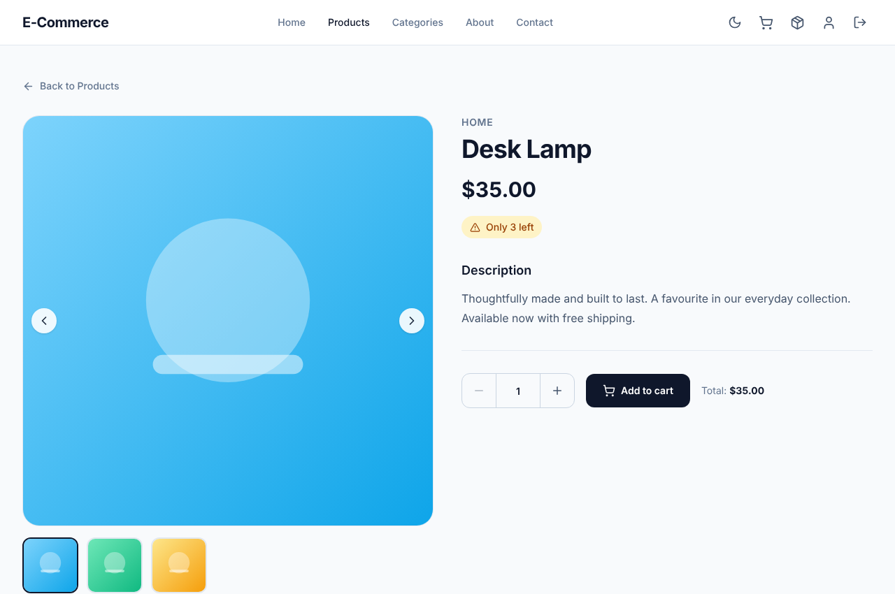 | 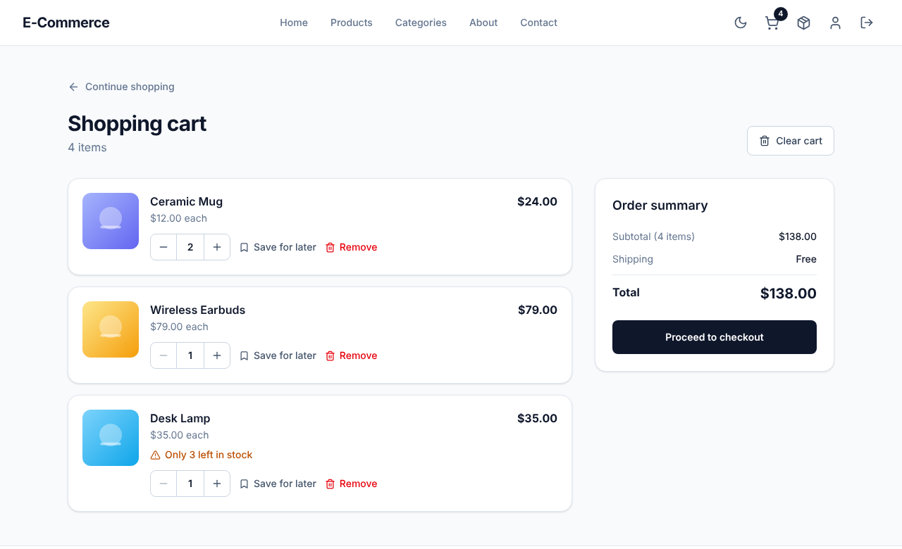 |

| Checkout review | Order tracking |
|---|---|
| 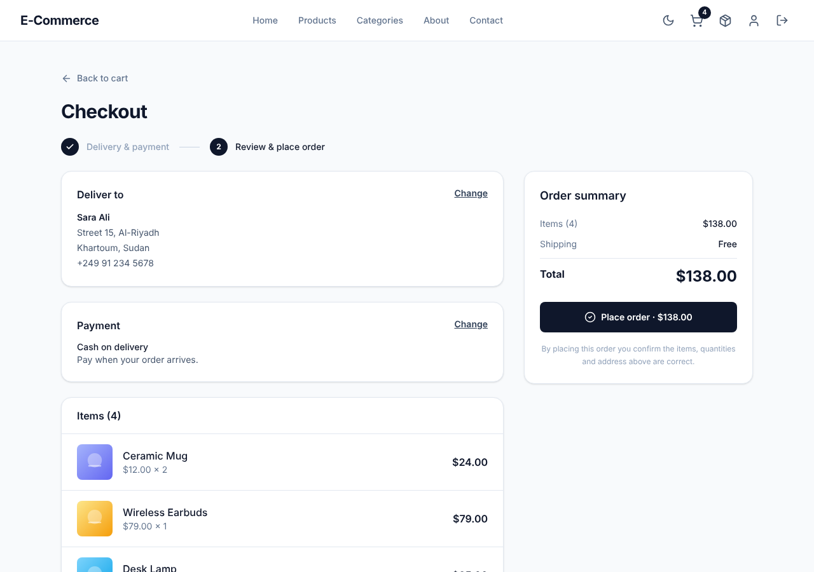 | 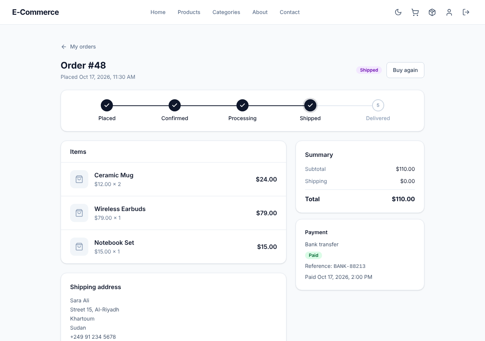 |

### Admin

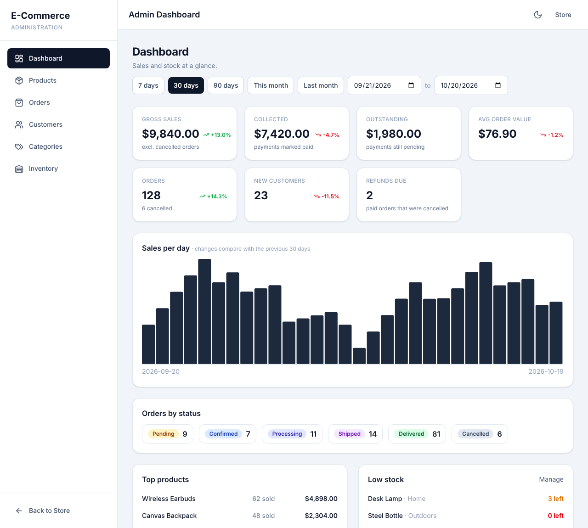

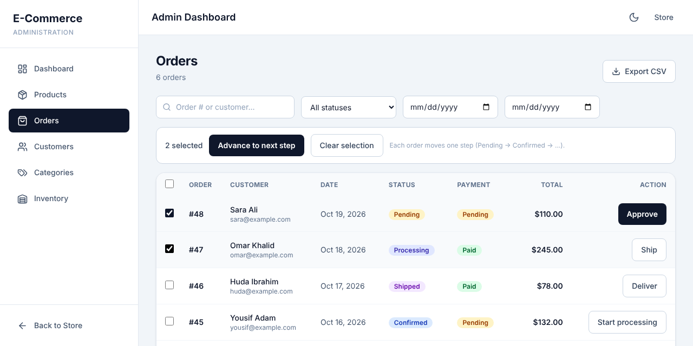

### Mobile

<p>
  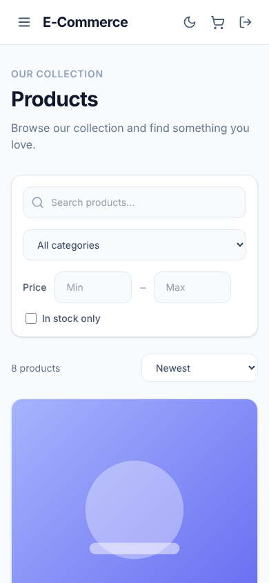
  &nbsp;&nbsp;
  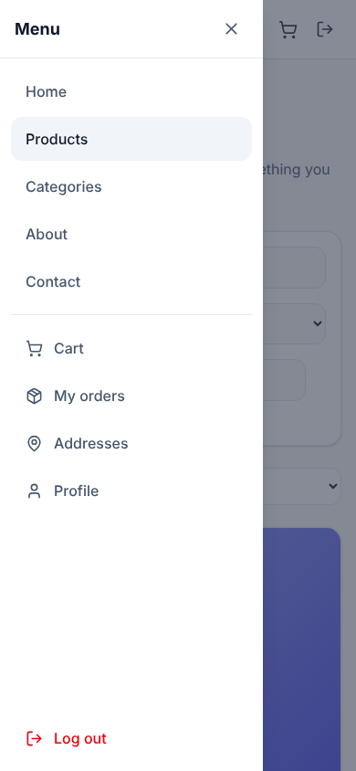
</p>

---

## 🧰 Tech stack

| Area | Choice |
|---|---|
| UI | React 19, React Router 7 |
| Language | TypeScript (strict, no unused locals) |
| Build | Vite 6 |
| Styling | Tailwind CSS 4, lucide-react icons |
| HTTP | Axios with request and refresh interceptors |
| State | Context API (Auth, Cart, Theme, Toast) |
| Tests | Vitest, Testing Library, jsdom |

The back-end is the **ASP.NET Core 10 Clean Architecture API** (MediatR, FluentValidation, EF Core, Identity + JWT) in the companion repository.

---

## 🚀 Getting started

**Prerequisites:** Node.js 20+ and the API running locally.

```bash
# 1. install
npm install

# 2. point the app at your API
cp .env.example .env        # then edit VITE_API_URL

# 3. run
npm run dev                 # http://localhost:5173
```

The API must allow this origin in its CORS policy (the policy is named `Frontend`).

### Environment

| Variable | Default | Description |
|---|---|---|
| `VITE_API_URL` | `http://localhost:5082/api` | Base URL of the API, including `/api`, without a trailing slash |

### Scripts

| Command | What it does |
|---|---|
| `npm run dev` | Dev server with hot reload |
| `npm run build` | Type-check, then production build into `dist/` |
| `npm run preview` | Serve the production build locally |
| `npm test` | Run the test suite once |
| `npm run test:watch` | Run tests in watch mode |

### Signing in as an admin

Admin pages need an account with the **Admin** role. Use the seeded administrator from your API's configuration. Customers register from the **Register** page.

---

## 🗂️ Project structure

```
src/
├── components/
│   ├── common/      shared UI: skeletons, pagination, dialogs, error boundary
│   ├── products/    product card and filters
│   ├── orders/      order progress tracker
│   └── admin/       invoice sheet, stock adjustment dialog
├── context/         Auth, Cart, Theme and Toast providers
├── hooks/           useReorder, useSavedForLater
├── layouts/         MainLayout (store) and AdminLayout
├── pages/           one folder per area; admin pages are lazy-loaded
├── routes/          AppRoutes, ProtectedRoute (signed in), AdminRoute (Admin role)
├── services/        typed API calls; api.ts holds the axios client + token refresh
├── types/           shapes of the API responses
└── utils/           money/date formatting, CSV export, cart stock rules
```

---

## 🔌 API endpoints used

<details>
<summary>Click to expand</summary>

| Area | Endpoints |
|---|---|
| Auth | `POST /auth/login` · `register` · `refresh` · `logout` · `change-password`, `GET/PUT /auth/me` |
| Products | `GET /products`, `GET /products/{id}`, create / update, `PATCH …/activate` · `deactivate` · `stock`, image upload / primary / delete |
| Categories | `GET/POST /categories`, `PUT /categories/{id}`, `PATCH …/activate` · `deactivate` |
| Cart | `GET/DELETE /cart`, `POST /cart/items`, `PUT/DELETE /cart/items/{productId}` |
| Addresses | `GET/POST /addresses`, `PUT/DELETE /addresses/{id}`, `PATCH …/default` |
| Orders (customer) | `GET/POST /orders`, `GET /orders/{id}`, `PUT /orders/{id}/cancel` |
| Orders (admin) | `GET /orders/admin`, `GET /orders/admin/{id}`, `PUT /orders/{id}/confirm` · `processing` · `ship` · `deliver` · `payment/confirm` (suffix `/Admin`) |
| Customers (admin) | `GET /customers`, `GET/PUT /customers/{id}`, `POST …/activate` · `deactivate` |
| Dashboard (admin) | `GET /admin/dashboard/summary` · `top-products` · `sales-by-day` · `low-stock` |

The admin order calls first try the routes above and fall back to `/admin/orders/...`, so the app works with either route layout.

</details>

---

## 🧪 Testing

```bash
npm test
```

Tests cover the cart stock rules, the admin "Approve" flow, the order progress tracker, CSV export (including spreadsheet-formula protection), API error messages, the error boundary and the 404 page.

---

## 📝 Notes and limitations

- **Price and in-stock filters** run in the browser over the first 100 matching products, because the API has no such filters. Search, category and sort are server-side.
- **Order search** in the admin panel loads up to 2,000 orders into the browser for the same reason.
- **Save for later** and the theme are stored in `localStorage` for each browser.
- **Admin cancel** is not available yet: the API has no admin cancel endpoint.

---

## 🗺️ Roadmap

- [ ] Admin customer details page with order history
- [ ] Arabic language and right-to-left layout
- [ ] Wishlist and product reviews (needs API support)
- [ ] End-to-end tests with Playwright

---

## 📄 License

Add your license here (for example MIT) and a `LICENSE` file at the repository root.
