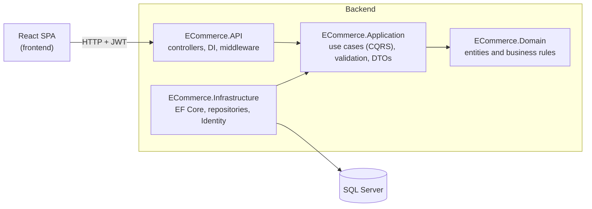

<div align="center">

# 🛍️ E-Commerce Platform

**A full-stack online store: a React storefront and admin dashboard on top of an ASP.NET Core Clean Architecture API.**


</div>

> Screenshots were captured from the running app with **demo data**. No real customers or orders appear.

---

## 📚 Table of contents

- [Overview](#-overview)
- [Features](#-features)
- [Screenshots](#-screenshots)
- [Architecture](#-architecture)
- [Tech stack](#-tech-stack)
- [Getting started](#-getting-started)
- [Configuration](#-configuration)
- [Project structure](#-project-structure)
- [API overview](#-api-overview)
- [Business rules](#-business-rules)
- [Testing](#-testing)
- [Notes and limitations](#-notes-and-limitations)
- [Roadmap](#-roadmap)
- [License](#-license)

---

## 🔎 Overview

This repository contains both halves of an e-commerce application:

| Part | Folder | What it is |
|---|---|---|
| **Back-end** | [`backend/`](backend) | ASP.NET Core 10 Web API built with Clean Architecture, CQRS (MediatR), EF Core and ASP.NET Identity with JWT. |
| **Front-end** | [`frontend/`](frontend) | React 19 + TypeScript single-page app with a customer storefront and an admin dashboard. |

Customers can browse products, fill a cart, check out with cash on delivery or bank transfer, and track their orders. Administrators manage products, categories, customers and orders, and watch sales on a dashboard.

---

## ✨ Features

### Customer
- Browse and search products with category, price, in-stock and sort filters. Filters live in the URL, so any view can be shared.
- Product page with image gallery and zoom, quantity limited to available stock, low-stock badge and related products.
- Cart with live stock warnings, **save for later**, and a blocked checkout while an item is unavailable.
- Two-step checkout: choose an address and payment method, then review and place the order.
- Order tracking (Placed → Confirmed → Processing → Shipped → Delivered), cancellation while allowed, and **Buy again**.
- Address book with a default address, profile editing and password change.

### Administrator
- **Dashboard**: revenue, collected and outstanding payments, average order value, daily sales chart, orders by status, top products, low stock, and change versus the previous period.
- **Orders**: filter, search, approve or advance orders, bulk advance, export to CSV, and print invoices and packing slips.
- **Products**: create and edit, upload images, set the primary image, activate or deactivate, adjust stock.
- Categories, customers and inventory screens.

### Platform
- JWT access tokens with rotating, hashed refresh tokens.
- Role-based authorization (`Customer`, `Admin`).
- Optimistic concurrency (row versions) on products, orders and refresh tokens, so two people can't overwrite each other's changes.
- Request validation with FluentValidation and consistent `ProblemDetails` error responses.
- Dark mode, responsive layout, route-level code splitting and skeleton loaders on the front-end.

---

## 📸 Screenshots

### Shopping

| Products (light) | Products (dark) |
|---|---|
|  |  |

| Product details | Cart with stock warnings |
|---|---|
|  |  |

| Checkout review | Order tracking |
|---|---|
|  |  |

### Administration


### Mobile

<p>
  
  &nbsp;&nbsp;
  
</p>

---

## 🏛️ Architecture

The back-end follows **Clean Architecture**. Dependencies point inward: the domain knows nothing about the database or the web.



| Layer | Responsibility |
|---|---|
| **Domain** | Entities (`Product`, `Order`, `Cart`, `Customer`, `Payment`, `Address`, `Category`) and the rules that keep them valid, such as the order status flow. |
| **Application** | One MediatR command or query per use case, FluentValidation validators, a validation pipeline behaviour, DTOs and repository interfaces. |
| **Infrastructure** | `AppDbContext`, EF Core configurations and migrations, repository implementations, Identity and JWT token services. |
| **API** | Thin controllers, authentication and authorization setup, CORS, Swagger, global exception handler and file uploads. |

---

## 🧰 Tech stack

| Area | Technology |
|---|---|
| Back-end | .NET 10, ASP.NET Core Web API |
| Patterns | Clean Architecture, CQRS with MediatR 14, Repository and Unit of Work |
| Data | Entity Framework Core 10, SQL Server |
| Auth | ASP.NET Core Identity, JWT bearer tokens, refresh tokens |
| Validation and mapping | FluentValidation 12, AutoMapper |
| API docs | Swagger (Swashbuckle) |
| Front-end | React 19, TypeScript (strict), Vite 6, React Router 7 |
| Styling | Tailwind CSS 4, lucide-react icons |
| HTTP and state | Axios with refresh interceptor, Context API |
| Front-end tests | Vitest, Testing Library |

---

## 🚀 Getting started

### Prerequisites
- [.NET 10 SDK](https://dotnet.microsoft.com/download)
- SQL Server (LocalDB, Express or full) and the `dotnet-ef` tool: `dotnet tool install --global dotnet-ef`
- [Node.js 20+](https://nodejs.org)

### 1. Clone

```bash
git clone <https://github.com/Ham-Mad37/ECommerceAppWithCleanArchitecture.git>
cd <src/ECommerce.API>
```

### 2. Run the API

```bash
cd backend

# create the database (uses ConnectionStrings:DefaultConnection)
dotnet ef database update --project src/ECommerce.Infrastructure --startup-project src/ECommerce.API

# start the API on http://localhost:5082
dotnet run --project src/ECommerce.API --launch-profile http
```

Open **http://localhost:5082/swagger** to explore the API (Development only).

On first start the API creates the `Customer` and `Admin` roles and a default administrator. 

### 3. Run the front-end

```bash
cd frontend
npm install
cp .env.example .env        # set VITE_API_URL if your API is not on port 5082
npm run dev                 # http://localhost:5173
```

Register a customer from the **Register** page, or sign in with the seeded administrator to reach the admin area.

---

## ⚙️ Configuration

### Back-end (`backend/src/ECommerce.API/appsettings.json`)

| Setting | Purpose |
|---|---|
| `ConnectionStrings:DefaultConnection` | SQL Server connection string. |
| `Jwt:Key` | Secret used to sign tokens. **Replace the placeholder** with a long random value. |
| `Jwt:Issuer` / `Jwt:Audience` | Token issuer and audience. |
| `Jwt:ExpirationMinutes` | Access token lifetime (default 15). |
| `Jwt:RefreshTokenExpirationDays` | Refresh token lifetime (default 7). |
| `Cors:AllowedOrigins` | Origins allowed to call the API. Includes `http://localhost:5173` for the Vite dev server. |
| `Storage:UploadsPath` | Folder for uploaded product images, served from `/uploads`. |
| `Storage:PublicBaseUrl` | Optional public base URL for image links. |


```bash
export Jwt__Key="<a-long-random-secret>"
export ConnectionStrings__DefaultConnection="Server=...;Database=...;..."
```

### Front-end (`frontend/.env`)

| Variable | Default | Purpose |
|---|---|---|
| `VITE_API_URL` | `http://localhost:5082/api` | API base URL, including `/api`, without a trailing slash. |

---

## 🗂️ Project structure

```
.
├── backend/
│   ├── ECommerce.slnx
│   ├── src/
│   │   ├── ECommerce.Domain/          entities, domain exceptions
│   │   ├── ECommerce.Application/     features (CQRS), validators, DTOs, interfaces
│   │   │   └── Features/              Addresses, Authentication, Carts, Categories,
│   │   │                              Customers, Dashboard, Orders, Products
│   │   ├── ECommerce.Infrastructure/  EF Core, migrations, repositories, Identity
│   │   └── ECommerce.API/             controllers, DI, Program.cs, appsettings
│   └── tests/                         unit and integration test projects
├── frontend/
│   ├── src/
│   │   ├── components/                shared UI, product, order and admin components
│   │   ├── context/                   Auth, Cart, Theme, Toast
│   │   ├── hooks/                     useReorder, useSavedForLater
│   │   ├── layouts/                   store and admin layouts
│   │   ├── pages/                     storefront and admin pages
│   │   ├── routes/                    route definitions and guards
│   │   ├── services/                  typed API client
│   │   ├── types/                     API shapes
│   │   └── utils/                     formatting, CSV export, cart rules
│   └── README.md                      front-end notes
└── docs/screenshots/                  images used in this README
```

---

## 🔌 API overview

Base URL: `http://localhost:5082/api`. Full, interactive documentation is available in Swagger.

| Area | Endpoints | Access |
|---|---|---|
| **Auth** | `POST /Auth/register` · `login` · `refresh` · `logout` · `change-password`, `GET/PUT /Auth/me` | Public / signed in |
| **Products** | `GET /Products`, `GET /Products/{id}` | Public |
| | `POST`, `PUT`, `PATCH …/activate` · `deactivate` · `stock`, image upload / primary / delete | Admin |
| **Categories** | `GET /Categories`, `GET /Categories/{id}` | Public |
| | `POST`, `PUT`, `PATCH …/activate` · `deactivate` | Admin |
| **Cart** | `GET`, `DELETE /Cart`, `POST /Cart/items`, `PUT` / `DELETE /Cart/items/{productId}` | Customer |
| **Addresses** | `GET`, `POST /Addresses`, `PUT`, `DELETE /Addresses/{id}`, `PATCH …/default` | Customer |
| **Orders** | `GET`, `POST /Orders`, `GET /Orders/{id}`, `PUT /Orders/{id}/cancel` | Customer |
| **Order administration** | list, details, confirm, processing, ship, deliver, confirm payment | Admin |
| **Customers** | list, details, update, activate, deactivate | Admin |
| **Dashboard** | `GET /admin/dashboard/summary` · `top-products` · `sales-by-day` · `low-stock` | Admin |

Product list query parameters: `pageNumber`, `pageSize`, `search`, `categoryId`, `isActive`, `sortBy` (`id`, `name`, `price`, `stockQuantity`), `sortDirection`. Paged responses look like `{ items, pageNumber, pageSize, totalCount, totalPages }`.

Errors follow the `ProblemDetails` format. Validation failures return `400` with an `errors` object, and business-rule conflicts return `409`.

---

## 📐 Business rules

**Order lifecycle**

```
Pending → Confirmed → Processing → Shipped → Delivered
   └──────────┴──────────┘
        Cancelled (stock returns to inventory)
```

**Payments**

| Method | Behaviour |
|---|---|
| Cash on delivery | The order can ship without prior payment. |
| Bank transfer | An administrator confirms the transfer, with a reference, before the order ships. |

Payment status is one of `Pending`, `Paid`, `Cancelled` or `RefundDue` (a paid order that was cancelled).

**Stock**: stock is checked when items are added to the cart and again when the order is placed. Cancelling an order returns its items to stock.

**Roles**: `Customer` and `Admin`. Customer accounts are linked to a customer profile; the JWT carries a `customerId` claim.

---

## 🧪 Testing

**Front-end** (Vitest and Testing Library):

```bash
cd frontend
npm test
```

Tests cover cart stock rules, the admin approve flow, the order progress tracker, CSV export, API error handling, the error boundary and the 404 page.

**Back-end**: the solution contains `ECommerce.UnitTests` and `ECommerce.IntegrationTests` (xUnit) projects, ready for tests. Run them with:

```bash
cd backend
dotnet test
```

---

## 📝 Notes and limitations

- Price and in-stock filters run in the browser over the first 100 matching products, because the API has no such filters.
- Order search in the admin panel loads up to 2,000 orders into the browser for the same reason.
- "Save for later" and the theme preference are stored in `localStorage`, per browser.
- The database is not migrated automatically on start-up. Run `dotnet ef database update` after pulling changes.

---

**Features**
- [ ] Admin customer details page with order history.
- [ ] Arabic language and right-to-left layout.
- [ ] Wishlist and product reviews.
- [ ] End-to-end tests with Playwright.
- [ ] Docker Compose for the API, database and front-end.

---

## 📄 License
MIT LICENSE
